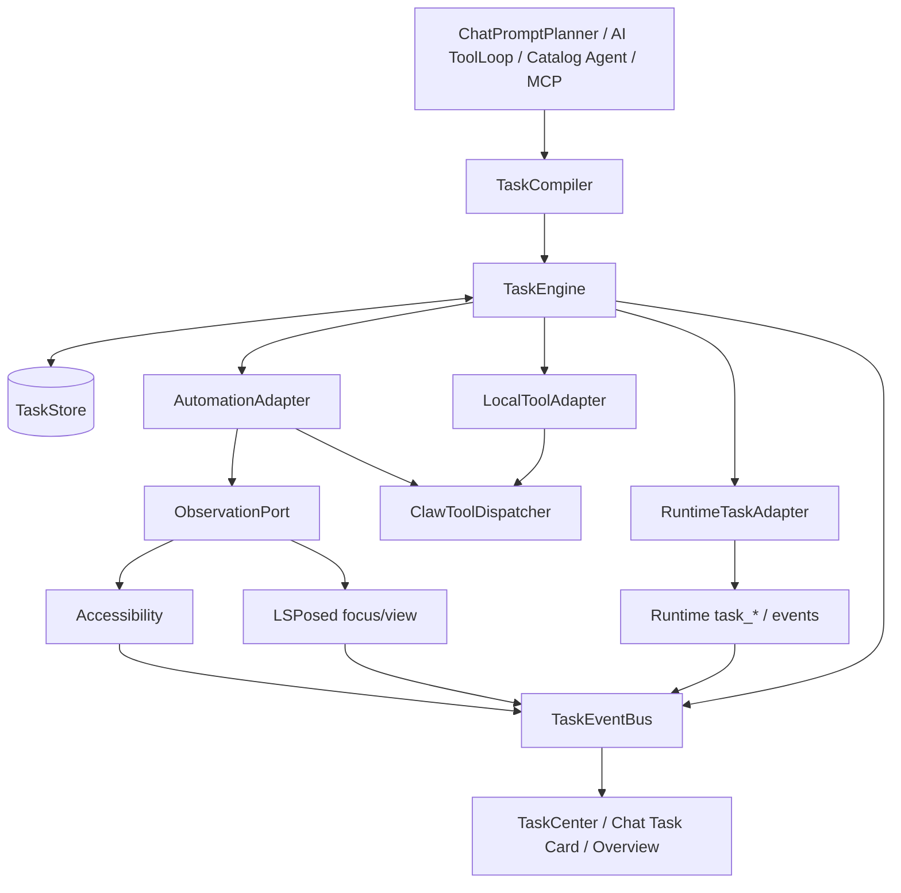

# 统一任务执行与自动化适配设计

- 状态：已批准，实施中
- 批准日期：2026-11-27
- 适用范围：ClawApp 任务编排、Runtime task 适配、页面自动化、任务台与恢复
- 约束来源：[architecture.md](architecture.md)、[agent-architecture.md](agent-architecture.md)、[AGENTS.md](../AGENTS.md)

## 1. 目标

统一 ClawApp 内多步骤任务的规划、执行、观察、取消、重试、暂停与恢复，覆盖：

1. Runtime 原生任务与 App 本地任务。
2. 页面确认、目标解析、安全点击等本地自动化。
3. LSPosed focus/view 与无障碍快照的融合观察。
4. Chat 任务卡与独立任务中心的状态展示。

执行真相只保留一份：`TaskEngine`。`ChatViewModel`、`OverviewController`、Agent Runner 不再各自维护任务生命周期。

## 2. 非目标

- 不新增开放网络入口。
- 不把 App↔Runtime 从 JSON-over-UDS 改为其他协议。
- 不实现 `WaitingSignal` 到 Runtime 的人工放行 IPC；人工确认仍留在 App。
- 第一版不引入 OCR、截图理解或端侧小模型。
- 不默认开启任何目标 App 的深度 Xposed 业务自动化。
- 不改变 Runtime 现有并发上限、鉴权与审计边界。

## 3. 现状与缺口

当前已经具备：

- Runtime `task_*` 状态机、重试、取消、补偿与 `task_state_changed` 事件。
- `ChatTaskExecutionController`、`RuntimeTaskPoller`、Chat 任务卡和历史持久化。
- `ClawToolDispatcher` 的统一工具入口、权限门和串行化 lane。
- `AutomationRuntimeStore` 的无障碍快照、页面确认、目标解析与坐标缓存。
- LSPosed focus/view 采集、Live store、Runtime 回写和白名单适配器。
- `AgentKernel` / `AgentRunStore` 的 Run 生命周期与未完成 Run 持久化。

主要缺口：

- 本地任务与 Runtime 任务使用不同状态模型和恢复路径。
- 本地自动化状态寄生在 `AutomationRuntimeStore`，无法作为混合任务步骤检查点化。
- 安全点击依赖全局“最近目标”，缺少快照代次与新鲜度绑定。
- LSPosed 与无障碍快照没有统一的来源、时效和诊断契约。
- 任务历史、Run、Runtime task 与 UI 任务卡之间需要手工同步。
- 自动化失败缺少稳定错误分类和可操作诊断。

## 4. 总体架构



## 5. 组件边界

### 5.1 `agent/task`

新增统一任务模型和执行内核：

- `ExecutionTask`：逻辑任务、目标、步骤、状态、attempt、Runtime task 关联和检查点。
- `ExecutionStep`：工具步骤、Runtime 子任务步骤、观察步骤、自动化步骤、人工确认步骤。
- `TaskCheckpoint`：已完成步骤 ID、下一步索引、步骤尝试次数、结果摘要和时间戳。
- `TaskFailure`：稳定错误码、摘要、详情、是否可重试、来源组件。
- `TaskEngine`：唯一状态写入者；负责任务调度、暂停、恢复、重试、取消和事件发布。
- `TaskCompiler`：把 `AgentPlan`、Catalog Agent 定义和直接命令编译为统一步骤。

`TaskEngine` 不直接访问 Compose、Activity 或 Runtime socket。

### 5.2 `data/TaskStore`

- 使用版本化 JSON 与现有 `SharedPreferences` 风格，不引入新数据库依赖。
- 保存活动任务、最近历史和检查点；设置条数与序列化体积上限。
- 从 `ChatTaskHistoryStore` 迁移旧任务记录。
- `AgentRunStore` 继续保存 Run 的记忆与规划上下文，但通过 `executionTaskId` 引用 TaskStore，不再重复保存执行状态。

### 5.3 `tools/adapters`

- `LocalToolAdapter`：通过 `ClawToolDispatcher` 执行普通工具，保留权限门、InputGuards 和串行化 lane。
- `RuntimeTaskAdapter`：
  - 纯 Runtime 可映射序列整包 `task_submit`。
  - 混合序列由 TaskEngine 逐步调用 Dispatcher。
  - 监听 `task_state_changed`，断线后使用 `task_get` / `task_list` 重同步。
- `AutomationAdapter`：把观察、页面确认、目标解析和安全点击编译为独立步骤。

### 5.4 `ObservationPort`

统一观察契约：

- `source`：`lsposed_focus`、`lsposed_view`、`accessibility`。
- `packageName`、`activityClass`、`generation`、`timestamp`、`freshnessMs`。
- 语义节点、可点击目标、焦点摘要和原始快照引用。

选择规则：

1. 包名匹配且新鲜度满足阈值时优先 LSPosed focus/view。
2. LSPosed 缺失、过期或包名不匹配时回退无障碍。
3. 两者都不可用时返回 `observation_unavailable`，不执行点击。

### 5.5 `ui/task`

- `TaskCenterViewModel` 只观察 `TaskStore` / `TaskEventBus`，不实现执行循环。
- 任务中心展示活动任务、历史、步骤时间线、诊断和操作。
- Chat 任务卡是同一任务的紧凑投影。
- Overview 只展示当前任务摘要和环境能力，不重复维护任务状态。

## 6. 任务模型与状态机

统一状态：

```text
Created -> Queued -> Running <-> WaitingSignal
                    |  ^
                    v  |
                 Retrying
                    |
        +-----------+-----------+
        |           |           |
     Succeeded      Failed      Cancelled
```

补充状态：

- `Paused`：本地暂停调度，已进入的步骤按取消策略收尾。
- `Compensating`：仅用于显式配置补偿步骤的任务。

核心不变量：

1. 只有一个 `TaskEngine` 实例能修改任务状态。
2. 每个步骤有稳定 `stepId` 与副作用幂等键。
3. 已完成步骤不会在恢复时重放。
4. Runtime task ID 是恢复锚点；本地 task ID 是逻辑任务锚点。
5. 取消请求去重，且取消终态不可回退。
6. 人工确认步骤在恢复后必须重新确认，不能自动放行。

## 7. 暂停、恢复与重试

### 7.1 检查点

每个步骤开始、完成、失败或进入等待时更新检查点：

- `nextStepIndex`
- 已完成 `stepId`
- 当前步骤 `attempt`
- Runtime task ID
- 最近结果摘要
- 等待原因与快照代次

检查点写入必须在步骤副作用提交前标记 `Running`，完成后标记 `Succeeded`。进程在副作用已发生但检查点未完成时崩溃，恢复策略为：

- 幂等步骤可直接重试。
- 非幂等步骤进入 `AwaitUser`，由用户决定是否重试或跳过。

### 7.2 恢复

- Runtime 子任务：按 task ID 查询并绑定事件。
- 本地工具步骤：从 `nextStepIndex` 继续。
- 自动化步骤：重新获取观察快照，旧 resolution token 失效。
- 人工确认步骤：保持 `AwaitUser`，等待新的用户动作。

### 7.3 重试

- 重试是同一逻辑任务的新 attempt，记录 `retryOf`。
- 步骤级重试沿用 Runtime 的指数退避思想，但由 TaskEngine 统一管理本地步骤。
- 只有标记为可重试的错误自动重试；权限、策略拒绝和用户取消不自动重试。

## 8. 自动化适配

### 8.1 步骤类型

- `ObservePage`：获取统一快照。
- `ConfirmPage`：校验包名、文本和 view ID。
- `ResolveTarget`：返回目标候选与诊断。
- `SafeTap`：使用 resolution token 执行点击。

### 8.2 Resolution Token

`TargetResolution` 包含：

- `targetId`
- `label`
- `bounds`
- `packageName`
- `snapshotGeneration`
- `source`
- `resolvedAtEpochMs`

`SafeTap` 只接受当前包名与快照代次仍有效的 token。页面变化后必须重新解析。

### 8.3 错误分类

- `observation_unavailable`
- `snapshot_stale`
- `package_mismatch`
- `target_not_found`
- `target_ambiguous`
- `permission_missing`
- `injection_rejected`
- `adapter_unavailable`

每个错误必须携带来源、期望值、实际值和可执行建议。

## 9. 人工确认与安全边界

- `AgentPolicy` 与 `ToolPermissionGate` 继续作为执行前硬边界。
- 高风险步骤在执行前和恢复后重新评估。
- `RequireConfirm` 生成 `AwaitUser` 检查点，不进入 Runtime。
- 用户拒绝后任务进入 `Cancelled` 或 `Failed`，不继续后续步骤。
- MCP 单工具调用仍走 Dispatcher；多步 Agent 调用统一进入 TaskEngine。

## 10. 事件与同步

事件来源：

- Runtime：`task_state_changed`、`window_changed`、`xposed_focus_changed`、`xposed_view_changed`。
- App：步骤状态、检查点、人工确认、取消和重试。

同步规则：

1. Runtime 事件按 task ID 合并，不乱序回退状态。
2. 断线重连后主动查询活动 Runtime task。
3. LSPosed/无障碍事件只更新观察缓存，不直接修改任务终态。
4. UI 只消费 `TaskEventBus` 的不可变快照。

## 11. 迁移策略

1. 新 TaskEngine 与旧控制器并存，先只接入新任务。
2. Runtime 健康检查、Probe、截图等 Catalog Agent 切换到 TaskEngine。
3. Chat 任务卡改为 TaskEngine 投影。
4. 本地自动化步骤切换到 AutomationAdapter。
5. 迁移旧 `ChatTaskHistoryStore` 数据。
6. 删除重复的本地任务状态机和无全局 token 的安全点击路径。

每一步都必须可独立回退，且保留旧数据只读迁移。

## 12. 分阶段实施

### 阶段 0：设计基础

- 设计文档、实施计划、任务模型和状态机测试。

### 阶段 1：执行内核

- `ExecutionTask` / `ExecutionStep` / `TaskCheckpoint` / `TaskFailure`。
- `TaskEngine`、`TaskStore`、`TaskEventBus`。
- Local / Runtime / Automation 适配器接口和 fake 测试实现。

### 阶段 2：Runtime 任务统一

- 接入 `RuntimeTaskAdapter`。
- 迁移 Runtime Catalog Agent 和 Chat 任务卡。
- 统一取消、重试、事件重同步。

### 阶段 3：本地恢复

- 检查点、暂停/恢复、进程重启恢复。
- 幂等键与非幂等步骤人工复核。
- 旧任务历史迁移。

### 阶段 4：自动化诊断

- ObservationPort、LSPosed/无障碍融合。
- Resolution token、错误分类、安全点击门禁。

### 阶段 5：任务中心与真机收口

- TaskCenter UI、时间线、历史与诊断。
- xaga 真机混合任务、恢复、取消和自动化烟测。
- 更新架构文档、协议说明和兼容矩阵。

每个阶段完成后运行对应测试并创建独立提交。

## 13. 测试策略

### 单元测试

- 状态机所有合法/非法迁移。
- 检查点序列化与旧数据迁移。
- 暂停、恢复、取消和重试并发。
- 适配器映射与 Runtime task ID 绑定。
- 快照新鲜度、来源回退和目标歧义。
- resolution token 失效。

### 集成测试

- fake Dispatcher / Runtime client 下的混合任务。
- 进程重建后的检查点恢复。
- 事件丢失、乱序、断线重连。
- 权限回收、无障碍关闭、LSPosed 不可用。
- 人工确认拒绝与恢复后重新确认。

### UI 测试

- 任务卡与 TaskCenter 状态一致。
- 取消、重试、暂停/恢复操作。
- 长历史列表性能与稳定 key。

### 真机烟测

- xaga：Runtime 序列、本地自动化、进程杀死恢复、活跃取消、事件断线。
- 验证 `lsposed_runtime_loaded=true` 时 ObservationPort 选择 LSPosed。
- 验证无障碍回退和失败诊断。

## 14. 验收标准

1. 所有多步骤入口使用同一 TaskEngine。
2. 本地任务在步骤边界崩溃后可恢复；Runtime 任务按 ID 重绑定。
3. 已完成副作用步骤不会在恢复或重试时重复执行。
4. 同一任务取消只发送一次，终态不回退。
5. 过期、歧义或跨包目标不会触发点击。
6. LSPosed 不可用时自动回退无障碍，并记录来源。
7. 高风险动作恢复后仍需人工确认。
8. TaskCenter、Chat 任务卡和 Overview 状态一致。
9. xaga 真机完成混合任务与恢复烟测。
10. 每阶段独立提交，测试通过后再进入下一阶段。

## 15. 主要风险与缓解

| 风险 | 影响 | 缓解 |
|---|---|---|
| 副作用已执行但检查点未落盘 | 恢复后重复操作 | 幂等键；非幂等步骤进入人工复核 |
| Runtime 事件丢失或乱序 | UI 状态滞后 | task_get/task_list 重同步；状态版本合并 |
| LSPosed 快照过期 | 错误点击 | generation + freshness；安全点击前重新观察 |
| 自动化目标歧义 | 误触 | 多候选诊断；不自动选择 |
| 新旧任务系统并存 | 状态分叉 | 迁移期单写 TaskEngine；旧系统只读 |
| 范围膨胀 | 延期 | 按五阶段提交；每阶段独立验收 |
